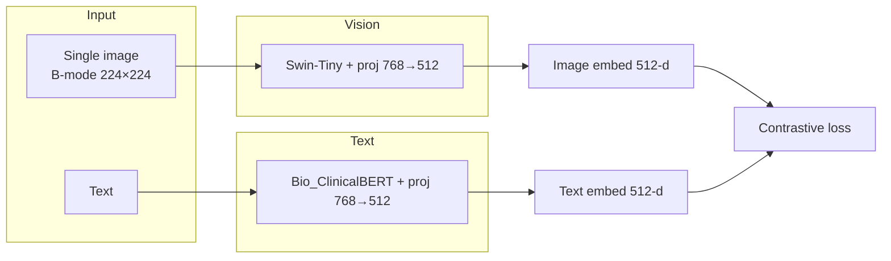
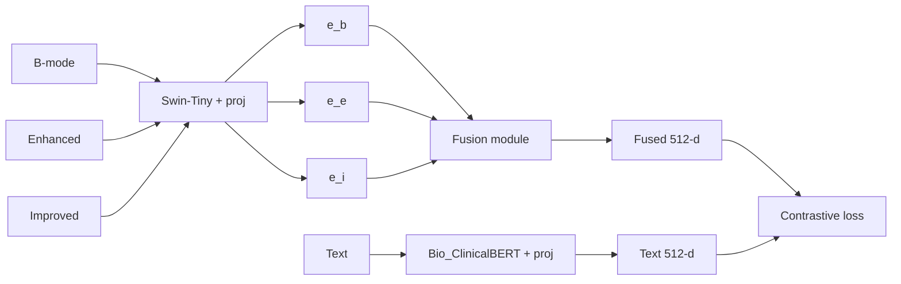

# PONS-CLIP

PONS-CLIP extends [MedCLIP](https://github.com/RyanWangZf/MedCLIP) for breast ultrasound: it fuses text with B-mode, enhanced, and improved images to compare B-mode-only finetuning with multi-feature fusion for embedding quality and keyword distances.

## Overview

- **Base**: MedCLIP (contrastive learning from unpaired medical images and text).
- **Data**: Breast ultrasound with up to three views per scan—**B-mode**, **enhanced**, and **improved** (enhanced/improved produced externally).
- **Comparison**:
  1. Finetuning with **B-mode only** (one image per sample).
  2. Finetuning with **B-mode + enhanced + improved** (one shared vision encoder, learnable fusion of three 512-d embeddings).

**Evaluations**: embedding visualizations (t-SNE, UMAP) by class, distances to keywords (e.g. *benign*, *malignant*, *ultrasound image*), clustering metrics, prompt-based classification, and text-prompt retrieval.

---

## Architecture and pretraining

Encoders are inherited from MedCLIP (ViT variant).

| Component | Model | Pretraining data |
|-----------|--------|-------------------|
| **Text** | [Bio_ClinicalBERT](https://huggingface.co/emilyalsentzer/Bio_ClinicalBERT) (BERT-base) | PubMed/PMC (BioBERT) → MIMIC-III clinical notes |
| **Vision** | [Swin-Tiny](https://huggingface.co/microsoft/swin-tiny-patch4-window7-224) (patch4, window7, 224×224) | ImageNet-1K |
| **Joint (MedCLIP)** | Both + 768→512 projection | ~20K medical image–text pairs |

PONS-CLIP loads MedCLIP’s joint checkpoint and finetunes on breast US; multi-feature adds a fusion module (weighted / MLP / attention) over the three image embeddings.

### B-mode only



### Multi-feature (B-mode + enhanced + improved)



Full encoder and pretraining details: [docs/ARCHITECTURE_AND_PRETRAINING.md](docs/ARCHITECTURE_AND_PRETRAINING.md).

---

## Project structure

```
PONS-CLIP/
├── README.md
├── requirements.txt
├── pons_clip/
│   ├── constants.py
│   ├── dataset.py
│   ├── evaluate.py
│   ├── fusion.py
│   ├── model.py
│   ├── prompt_classify.py
│   ├── prompts.py
│   ├── retrieve_by_prompt.py
│   ├── similarity_demo.py
│   ├── train.py
│   ├── visualize.py
│   └── warnings_config.py
├── configs/
│   ├── bmode_only.yaml
│   └── multifeature.yaml
├── data/
│   └── README.md
├── docs/
│   └── ARCHITECTURE_AND_PRETRAINING.md
└── scripts/
    ├── compare_bmode_vs_multifeature.sh
    ├── retrieve_compare.sh
    ├── run_eval_and_viz.sh
    ├── train_bmode.sh
    └── train_multifeature.sh
```

---

## Data format

Two options:

- **Folder-based**: `data/fold1/{train,val,test}/` with subdirs `bmode/`, `enhanced/`, `improved/`, each with `benign/` and `malignant/` containing PNGs. Recommended for the standard fold layout (see [data/README.md](data/README.md)).
- **Manifest-based**: CSV or JSON with columns such as `image_path`, `enhanced_path`, `improved_path`, `label`, and optional `text`.

---

## Setup

```bash
pip install -r requirements.txt
```

Install PyTorch for the target environment (e.g. [pytorch.org](https://pytorch.org)).

---

## Usage

**Training (folder-based, one fold):**

```bash
# B-mode only
python -m pons_clip.train --data_dir data/fold1 --output_dir outputs_bmode

# Multi-feature
python -m pons_clip.train --data_dir data/fold1 --use_multifeature --output_dir outputs_multifeature
```

**Evaluation and visualization:**

```bash
python -m pons_clip.evaluate --checkpoint outputs_bmode/pons_clip_final.pt --data_dir data/fold1 --output_dir eval_bmode
python -m pons_clip.visualize --embeddings_dir eval_bmode --output_dir plots --prefix bmode
```

**Compare B-mode vs multi-feature (eval + plots + clustering metrics):**

```bash
CKPT_BMODE=./outputs_bmode/pons_clip_final.pt CKPT_MF=./outputs_multifeature/pons_clip_final.pt \
DATA_DIR=data/fold1 bash scripts/compare_bmode_vs_multifeature.sh
```

**Prompt-based classification (no extra training):**

```bash
python -m pons_clip.prompt_classify --checkpoint outputs_bmode/pons_clip_final.pt --data_dir data/fold1 --output_dir eval_bmode
```

**Image–text similarity:**

```bash
python -m pons_clip.similarity_demo --checkpoint outputs_bmode/pons_clip_final.pt --image path/to.png --texts "benign" "malignant"
```

**Retrieve top similar scans by text prompt (train+val+test, copies to output dir):**

```bash
python -m pons_clip.retrieve_by_prompt --prompt "malignant ultrasound image with asymmetric lesion" \
  --data_dir data/fold1 --checkpoint outputs_multifeature/pons_clip_final.pt --use_multifeature \
  --splits all --top_k 3 --output_dir retrieval_output
```

---

## Additional capabilities

- **Prompt-based classification**: Class prompts in `pons_clip/constants.py` (`CLASS_PROMPTS`). Add or edit phrases per class for prompt ensembling.
- **Radiology reports**: The manifest supports a `text` column. For report-driven labels, tools such as the [CheXpert labeler](https://github.com/stanfordmlgroup/chexpert-labeler) or custom NER can be used to map reports to classes or prompt text.

---

## Citation

When using MedCLIP, cite:

```bibtex
@inproceedings{wang2022medclip,
  title={MedCLIP: Contrastive Learning from Unpaired Medical Images and Texts},
  author={Wang, Zifeng and Wu, Zhenbang and Agarwal, Dinesh and Sun, Jimeng},
  booktitle={EMNLP},
  year={2022}
}
```
