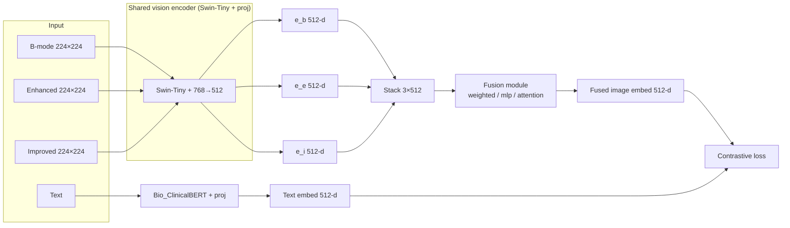
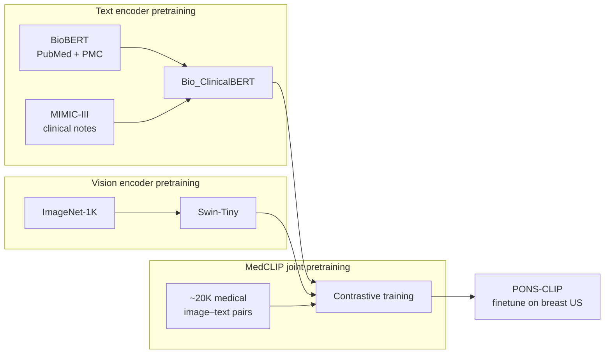

# PONS-CLIP: Encoder Architectures and Pretraining Data

## 1. Model identities (from MedCLIP)

| Component | Hugging Face / source | Notes |
|-----------|------------------------|--------|
| **Text encoder** | `emilyalsentzer/Bio_ClinicalBERT` | BERT-base, clinical domain |
| **Vision encoder** | `microsoft/swin-tiny-patch4-window7-224` | Swin Transformer (ViT-style), used as “MedCLIP-ViT” |

PONS-CLIP uses the **ViT variant** of MedCLIP (Swin-Tiny vision + Bio_ClinicalBERT text). MedCLIP also offers a ResNet50 vision variant; PONS-CLIP does not use it.

---

## 2. Text encoder: Bio_ClinicalBERT

- **Architecture**: BERT-base (12 layers, 768 hidden, 12 heads, max length 512; MedCLIP uses max length 77 for text).
- **Tokenization**: WordPiece, same as BERT; MedCLIP uses the tokenizer from `Bio_ClinicalBERT`.
- **How MedCLIP uses it**: Hidden states from **layers 1, 2, and last** are stacked, then mean-pooled over tokens and over those three layers, then passed through a **linear projection 768 → 512**. Output is L2-normalized.
- **Pretraining (Bio_ClinicalBERT)**:
  - **Initialization**: From **BioBERT** (pretrained on PubMed abstracts + PMC full-text articles).
  - **Continued pretraining**: On **MIMIC-III** clinical notes (ICU discharge summaries, radiology reports, etc.).
  - **Data**: All notes from the NOTEEVENTS table (~**880 million words**).
  - **Task**: Masked language modeling (MLM).
  - **Reference**: Alsentzer et al., “Publicly Available Clinical BERT Embeddings” (ClinicalNLP Workshop, 2019); [Hugging Face card](https://huggingface.co/emilyalsentzer/Bio_ClinicalBERT).

**Pretraining data for the text encoder**: PubMed/PMC (via BioBERT), then MIMIC-III clinical notes.

---

## 3. Vision encoder: Swin-Tiny (MedCLIP-ViT)

- **Architecture**: **Swin Transformer** (Swin-Tiny), hierarchical, window-based self-attention.
  - Input: **224×224** RGB; patch size **4×4**; window size **7×7**.
  - Depths: [2, 2, 6, 2] layers per stage; hidden dim 96 in first stage.
  - Original head: 1000-way ImageNet classifier (removed in MedCLIP).
- **How MedCLIP uses it**: Image → Swin backbone → **pooler output (768-d)** → **linear 768 → 512** (no bias). Output is L2-normalized.
- **Pretraining (Swin-Tiny)**:
  - **Initialization**: Pretrained on **ImageNet-1K** (classification).
  - **Reference**: Liu et al., “Swin Transformer: Hierarchical Vision Transformer using Shifted Windows” (ICCV 2021); [Hugging Face](https://huggingface.co/microsoft/swin-tiny-patch4-window7-224).

**Pretraining data for the vision encoder**: **ImageNet-1K** (natural images).

---

## 4. MedCLIP joint pretraining (before PONS-CLIP)

After the above base pretraining, MedCLIP **jointly** trains the two encoders (and projection layers) with contrastive learning on **medical** image–text pairs:

- **Data**: Unpaired medical images and radiology text; the paper reports strong results with only **~20K** image–text pairs (vs ~200K for some prior work).
- **Objective**: Contrastive (semantic matching) loss so that matching image–text pairs have similar 512-d embeddings and non-matching pairs are pushed apart.
- **Checkpoint**: PONS-CLIP loads these joint weights from MedCLIP (e.g. `from_pretrained()` → `medclip-vit-pretrained`), then **finetunes** on breast US data.

So in summary:

- **Text encoder pretraining data**: PubMed/PMC (BioBERT) + **MIMIC-III** clinical notes (Bio_ClinicalBERT).
- **Vision encoder pretraining data**: **ImageNet-1K** (Swin-Tiny).
- **Joint (MedCLIP) pretraining data**: **~20K medical image–text pairs** (medical images + associated text, domain not limited to breast US).

---

## 5. PONS-CLIP: B-mode vs multi-feature

- **Shared**: Same text encoder (Bio_ClinicalBERT + 768→512) and same vision encoder (Swin-Tiny + 768→512). Both are **finetuned** on breast US data (no freezing in the current setup).
- **B-mode**: One image per sample → vision encoder → one 512-d image embedding → contrastive loss with text.
- **Multi-feature**: Three images per sample (bmode, enhanced, improved). Each goes through the **same** vision encoder → three 512-d vectors → **fusion module** → one 512-d image embedding → contrastive loss with text. Fusion types: `weighted` (learned weights over the 3), `mlp`, or `attention`.

---

## 6. Architecture diagrams

Mermaid diagrams below render on GitHub or at [mermaid.live](https://mermaid.live).

### B-mode only

```mermaid
flowchart LR
  subgraph Input
    I[Single image\nB-mode 224×224]
    T[Text e.g.\n"benign breast US image"]
  end

  subgraph Vision
    V[Swin-Tiny\nImageNet-1K pretrained\n+ MedCLIP joint]
    V --> Vproj[Linear 768→512]
  end

  subgraph Text
    B[Bio_ClinicalBERT\nMIMIC-III + PubMed/PMC]
    B --> Bproj[Linear 768→512]
  end

  I --> V
  T --> B
  Vproj --> Eimg[Image embed 512-d]
  Bproj --> Etxt[Text embed 512-d]
  Eimg --> Loss[Contrastive loss]
  Etxt --> Loss
```

### Multi-feature (bmode + enhanced + improved)



### Pretraining data summary (flow)



---

## 7. Quick reference table

| Item | Text encoder | Vision encoder |
|------|----------------|-----------------|
| **Model** | Bio_ClinicalBERT (BERT-base) | Swin-Tiny (patch4, window7, 224×224) |
| **HF id** | `emilyalsentzer/Bio_ClinicalBERT` | `microsoft/swin-tiny-patch4-window7-224` |
| **Base pretraining data** | PubMed, PMC (BioBERT); then MIMIC-III clinical notes | ImageNet-1K |
| **MedCLIP joint pretraining** | ~20K medical image–text pairs (with vision encoder) | Same |
| **Output dim (before proj)** | 768 | 768 (pooler) |
| **Output dim (after proj)** | 512 (L2-norm) | 512 (L2-norm) |
| **PONS-CLIP** | Finetuned on breast US text | Finetuned; in multi-feature, shared across bmode/enhanced/improved, then fused |

This document summarizes encoder architecture and pretraining data, and the difference between B-mode and multi-feature setups.
